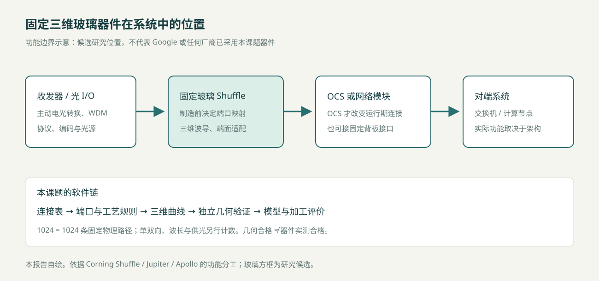
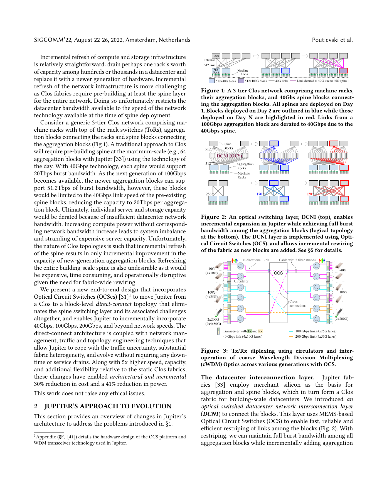

# OCS 与 Fiber Shuffle：固定三维玻璃互联的应用位置

调研截止：2026-10-28。引用键对应 `10_参考文献库.bib`，定位及访问深度见 `11_核心事实与证据台账.md`。**事实**来自原始资料；**推导**为本报告计算；**研究示例**不是已部署产品。

## 1. 核心判断

本项目最直接的功能是：给定端口坐标、端面方向和一一连接表，在玻璃内部生成固定的三维波导集合。它与 Fiber Shuffle 的功能接近；在 OCS 系统中只能承担外围重排、扇出、接口适配或固定级间连接。若无可控开关单元，它不能实现动态 OCS。[CorningShuffle][Apollo2022]

1024 条波导表示 1024 条独立物理路径：一端有 1024 个端点，另一端有 1024 个端点，共 2048 个波导端面。不能同时把它称作“总共 1024 个端口”和“1024 输入×1024 输出动态交换矩阵”。单向、双向和双纤双工需另列字段。

本报告自绘，功能分工依据下列原始资料；玻璃模块位置为研究候选。

## 2. OCS 的工作原理与系统层次

电分组交换 EPS 接收并处理分组，依据目的地址、队列与调度规则转发；光电收发通常位于端口。OCS 则在一段时间内建立端到端光电路，数据在该连接内透明通过。控制器改变电路映射后，网络的逻辑邻接关系才随之改变；链路训练、路由收敛和业务迁移时间不能等同于光开关本体切换时间。[Apollo2022]

| 技术 | 改变连接的方法 | 适合讨论的优势 | 必须付出的代价 |
|---|---|---|---|
| 自由空间三维 MEMS | 两组可倾斜微镜把输入束指向输出 | 高端口数、较少级联光学单元、速率透明 | 精密光机装配、反馈控制、毫秒级重构 |
| 硅光 MZI 网络 | 相移改变干涉输出，级联实现交换网络 | 可与光子芯片集成、热光或电光驱动 | 单元级联损耗、热串扰、偏振和校准要求 |
| 硅光 MEMS | 移动结构改变耦合 | 低静态驱动功耗的可能性 | 制造封装与机械可靠性，不能套用自由空间 MEMS 指标 |
| 波长选择／可调收发 | 改变波长及波长路由 | 可获得较快选择过程 | 需要波长计划、收发器协同；不是任意纤端重接 |
| 固定光纤／玻璃 Shuffle | 制造时确定连接表 | 运行中无需开关驱动 | 不能按业务动态改变映射 |

以上为机制分类，不能据此给出跨技术统一的“最好”结论。Apollo 表1是2022年特定规模的技术快照，不代表2026年所有产品上限。[Apollo2022]

Clos／Spine–Leaf 说明交换机之间的逻辑连接；MPO 中哪根纤对应哪个 lane、机架如何走缆，属于物理实现。Direct-connect／Direct Mesh 也不意味着所有节点均有独立直连纤。实际网络可以稀疏连接，并通过其他聚合块中转。[Jupiter2022]

## 3. Google Jupiter 与 Apollo：两个层面分别读

### 3.1 Jupiter 的网络层结论

Jupiter Evolving 是 Google 生产网络演进经验。其 Fig.1 对照原有三层 Clos，Fig.2 上部画出由 OCS 构成的 DCNI 物理层，下部画出聚合块的逻辑连接；Fig.3 表示环行器与 CWDM 收发器的关系。论文报告网络演进过程中的容量／速率约5倍、资本开支下降30%、功耗下降41%，以及生产流量平均聚合块级路径长度1.4。**这些是整套架构与运营共同取得的结果，不能归因于一块无源玻璃重排芯片。**[Jupiter2022, 摘要、§2、Fig.1–3]

图为原论文整页阅读辅助，保留上下文；正式论文如重绘，应标注“根据 Poutievski 等，2022，Fig.1–3 改绘”，并在引用前核对学校的图片使用规范。

### 3.2 Apollo 的器件层结论

Apollo 描述 Palomar 的自由空间三维 MEMS 实现：136×136 非阻塞映射、毫秒量级切换，文中代表性插入损耗通常低于2 dB，整机最大功耗108 W。136²=18496 是可选输入输出组合数；同一置换下最多136条独立配对，不是18496条同时存在的波导。[Apollo2022, §2–4、Fig.7]

环行器使 Tx/Rx 共享部分纤路并改变端口计数方法。因此不能根据“收发 lane 数×2”机械估算 Apollo 的物理纤数。MEMS 的“三维”是光束在自由空间内传播；本项目“三维”是波导中心线位于玻璃体内，两者不属于同一制造技术。

网络何时改变拓扑由控制系统决定；固定 Shuffle 可以把一组连接器的纤序映射到另一组连接器，但不代替 MEMS 的配置、反馈或网络流量工程。

## 4. Fiber Shuffle 的定义和拓扑

将固定器件定义为置换：输入集合 I、输出集合 O，双射 π:I→O；每个输入恰有一个输出，不复制、不合并。扇出可以仅表示空间阵列展开；若需要光功率一分多路，必须另设分束器，不能靠普通波导交叉实现。

典型结构包括：连接器内部纤序重排、Tx/Rx 归并、行列转置、端口分组间的全连接配线、背板盲插接口转换、单芯纤阵列至多芯纤阵列转换。厂商“2×2／4×4 Shuffle”往往指连接器或分组间的重排规格，必须索取逐纤接线表；不能默认指2根或4根纤，也不能把宣传中的“带宽增加”解释为无源器件创造了带宽。[CorningShuffle]

研究用4×4转置示例：输入按 `(i,j)` 排列，`i,j=0…3`，输出为 `(j,i)`；共有16条路径。输出编号 `π(4i+j)=4j+i`。它是16通道静态重排，不是4×4动态交换机。

MT 是多纤精密插芯；MPO 是连接器接口家族，MTP 是 US Conec 的相关商品名。标准常见250 µm纤芯中心间距不等于激光直写芯片的内部最小安全间距；后者取决于模场、耦合长度及工艺扰动。US Conec 的165 µm间距研究用80 µm包层纤，说明端面密度也在变化，不能把250 µm当作所有未来接口的固定常数。[USConec165]

## 5. 商业方案及反面证据

| 原始资料 | 可核实能力 | 对本项目的意义 | 不能从资料推出的内容 |
|---|---|---|---|
| Corning Shuffle Solutions | 面向AI/HPC和Spine–Leaf的被动Shuffle Box及Assembly，定制映射 | 证明真实需求是线序管理、安装和集成 | 该页未给统一插损、1024通道型号或价格 |
| Molex OptoConnect 数据表 | 自动 FlexPlane 制造，72至6400根纤、1至6 RU系列 | 已有超过1024物理纤规模；反驳“行业全部手工” | 不能把系列最大6400纤归到任意1 RU型号 |
| US Conec EZ Shuffle | 单模块最多256纤，可堆叠，41×84×9.5 mm | 是固定重排的直接体积与模块化基线 | 四模块合计1024纤不等于单模块任意1024置换 |
| IEEE 802.3 E4AI 2026 演示 | 比较线束、cassette、Shuffle Box和玻璃嵌入式3D重排 | 提供系统—器件映射和反面技术比较 | 演示不是全部所画规模的已部署证明 |

[CorningShuffle][MolexShuffle][USConecEZ][Castro2026]

Castro 2026 第13页明确提出三维直写玻璃的损耗高于 optical-flex Shuffle。其前页也承认物理布纤可由机器人自动完成。因此合理问题应是：在特定尺寸、端面和工艺约束下，玻璃是否能以可接受损耗换取集成密度和一致性，而不是“取代落后的手工光纤”。[Castro2026]

## 6. 应用实例A：OCS外围固定映射

**真实背景：** Jupiter DCNI需要大量固定端口接入可重构OCS。[Jupiter2022] **以下尺寸和1024数量为本报告构造的模块级研究示例，不是Google公开BOM。**

系统：聚合交换机光模块→光纤连接器阵列→固定玻璃Shuffle→OCS接口阵列→动态OCS→对端。

令32个输入分组各含32条单向光路，`I(a,b)` 接至 `O(b,a)`，总计1024条。玻璃负责组内序列与OCS接口次序转换，OCS仍在其后选择网络邻接；可用多块OCS或接口架分组承接，本例不假定一台136端口Palomar能接1024条独立输入。

主要约束为端面阵列布局、光预算、回波、偏振、维护边界、连接器和不同模块之间的容差。若采用环行器双向设计，应重写方向模型并评估反射；不能直接沿用单向1024线图。

是否必须1024？否。实际需求取决于系统BOM。1024作为批量模块的研究规模合理，但没有证据表明Google必须使用一块1024通道玻璃芯片。与光纤方案比较时，应对同一连接表和同一外部接口测量总体积、最坏插损及更换成本。

## 7. 应用实例B：AI集群Spine–Leaf固定转置

**真实背景：** Corning、Molex和IEEE演示均确认lane重排用于高密度交换网络。[CorningShuffle][MolexShuffle][Castro2026] **下列32×32为研究构造。**

令32个Leaf侧接口组和32个Spine侧接口组，每个Leaf组向每个Spine组提供一条单向纤路，合计 `32×32=1024` 条。输入端按Leaf分组，输出端按Spine分组，连接规则仍为 `I(l,s)→O(s,l)`。若Tx/Rx各走一根纤且需要完整双向配对，则需2048条物理路径，或把当前1024条解释为512对双工纤路。节点数、ASIC端口数、光纤数和波导数应分栏展示。

玻璃中可用升降、空间换序与端面扇出来避免近距离相遇。它改善的可能是固定连接模块，不负责分组交换、拥塞控制或运行期路由。低损耗、维修方便和量产成熟的光纤Shuffle必须作为基线；若只需稀疏连线或拓扑频繁升级，分块光纤组件可能更合适。

## 8. 真正的比较应如何做

对同一π和端口阵列，先设计光纤组件、二维玻璃、三维玻璃三套候选。固定外部接口与测量参考面，记录：芯片与完整组件体积；每通道插损分布及最坏值；串扰矩阵；连接良率；热循环漂移；装配工时；加工扫描长度；现场换件粒度及寿命成本。波导裸芯片比机架Shuffle Box小，并不能单独证明系统体积更小。

最终机会在于结构化固定连接、高密度阵列适配和可重复制造的数据链；限制在于低折射率差导致的弯曲空间、逐线扫描吞吐、端面装配、固定拓扑及整片失效更换。实际价值必须在相同边界条件下证明。

## 本文引用来源

完整作者、卷期、DOI及访问边界见10与11文件；下面给原始来源快捷链接。

- [CorningShuffle: Data Center Shuffling Solutions](https://www.corning.com/optical-communications/asean/en/home/products/shuffle-solutions.html)（未署年；访问B）
- [Apollo2022: Mission Apollo: Landing Optical Circuit Switching at Datacenter Scale](https://arxiv.org/abs/2208.10041)（2022；访问A）
- [Jupiter2022: Jupiter evolving: transforming google's datacenter network via optical circuit switches and software-defined networking](https://research.google/pubs/jupiter-evolving-transforming-googles-datacenter-network-via-optical-circuit-switches-and-software-defined-networking/)（2022；访问A）
- [USConec165: Next-generation multi-fiber ferrule using 165 micron pitch optical fiber](https://www.usconec.com/media/5gqn45fu/next-generation-multi-fiber-ferrule-using-165-micron-pitch-optical-fiber.pdf)（2021；访问A）
- [MolexShuffle: OptoConnect Aggregation Fiber Shuffle Boxes](https://www.molex.com/content/dam/molex/molex-dot-com/en_us/pdf/datasheets/987651-1657.pdf?inline=)（未署年；访问B）
- [USConecEZ: US Conec Introduces EZ Shuffle Solution for High Density Fiber Management](https://www.usconec.com/media/bldixi54/ez-shuffle-press-release.pdf)（2018；访问B）
- [Castro2026: Optical Shuffle Architectures for Large AI Networks](https://www.ieee802.org/3/ad_hoc/E4AI/public/26_0224/castro_e4ai_02_260224.pdf)（2026；访问A）
